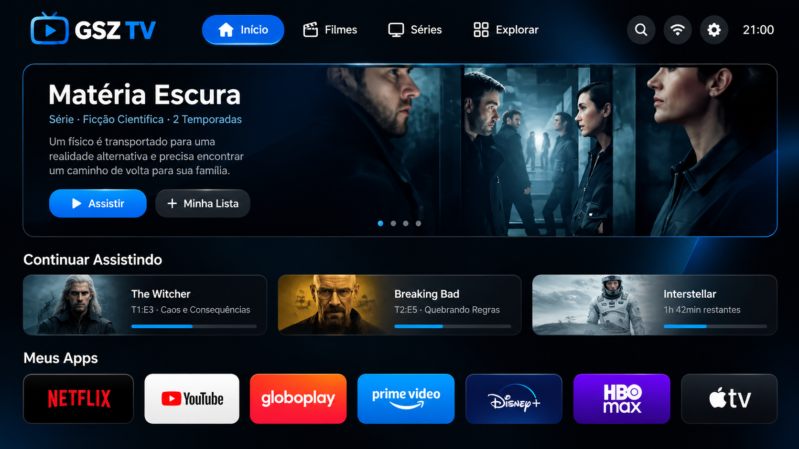

# GSZ TV — Launcher gratuito para Android TV, Google TV e projetores

**GSZ TV** é um launcher gratuito e sem anúncios para Android TV, Google TV e projetores Android. Este é o repositório oficial do projeto: aqui estão o código-fonte, o APK para download, as instruções de instalação e o histórico de versões. O GSZ TV foi criado por [@guisz-code](https://github.com/guisz-code) com auxílio de inteligência artificial (IA) e foi desenvolvido e testado principalmente em um projetor Magcubic HY300 com Android 12.

Baixe a versão mais recente na página de [Releases](https://github.com/guisz-code/GSZ-TV/releases/latest) ou consulte as [instruções de instalação](#baixar-e-instalar).

**English:** GSZ TV is a free, ad-free launcher for Android TV, Google TV and Android projectors. This is the official GSZ TV GitHub repository with source code, APK downloads and installation instructions.

<p align="center">
  
</p>

<p align="center">
  
</p>

<p align="center">
  <strong>Launcher leve, simples e sem anúncios para Android TV.</strong>
</p>

O GSZ TV oferece uma tela inicial personalizável e pensada para navegação com controle remoto. A imagem acima é uma prévia visual do design; a tela exibida no aparelho pode variar conforme o tema, as configurações e os aplicativos instalados.

> [!WARNING]
> O GSZ TV pode assumir a tela inicial do dispositivo em modelos compatíveis. Antes de ativá-lo, leia a seção [Depois da instalação](#depois-da-instalação). Caso necessário, é possível voltar para a tela inicial original nas configurações do aplicativo.

## Baixar e instalar

### Qual é o sistema da minha TV?

Abra as configurações da TV e procure **Sobre**, **Informações da TV** ou **Suporte**. Confira o modelo e a versão do sistema; se necessário, consulte o manual pelo modelo no site do fabricante.

| Sistema | Aparelhos | Como obter |
| --- | --- | --- |
| Android TV / Google TV | Projetores e TVs de várias marcas | APK `GSZTV.apk` na página de [Releases](https://github.com/guisz-code/GSZ-TV/releases/latest) |
| webOS | Alguns modelos de Smart TVs LG | Pacote experimental `.ipk` no [pré-release tv-v0.1.0](https://github.com/guisz-code/GSZ-TV/releases/tag/tv-v0.1.0) |
| Tizen | Alguns modelos de Smart TVs Samsung | Pacote experimental `.wgt` no [pré-release tv-v0.1.0](https://github.com/guisz-code/GSZ-TV/releases/tag/tv-v0.1.0); requer assinatura própria |

TVs LG e Samsung antigas podem usar outros sistemas (NetCast e Orsay). A marca sozinha não garante compatibilidade. Um aparelho Android conectado por HDMI tem seu próprio sistema, independente da TV.

### LG webOS e Samsung Tizen — versões experimentais

Os pacotes de webOS e Tizen estão disponíveis no pré-release [GSZ TV para LG webOS e Samsung Tizen — experimental 0.1.0](https://github.com/guisz-code/GSZ-TV/releases/tag/tv-v0.1.0). Eles compartilham a interface e a navegação por controle remoto do projeto-base Free My TV. Funcionam como aplicativos; a tela inicial do fabricante permanece. Não incluem os recursos específicos do Android, como gestão de processos, ADB ou ajustes de projeção do HY300, e ainda precisam de validação em TVs reais.

**LG:** instale o aplicativo Developer Mode da loja LG, entre com sua conta de desenvolvedor e ative Dev Mode Status e Key Server. No computador, instale o pacote `.ipk` usando as ferramentas oficiais webOS ou execute `python webos/install.py IP_DA_TV` a partir deste repositório. Digite a senha de pareamento somente no terminal. Mantenha a sessão Developer Mode renovada; quando expira, os aplicativos de desenvolvimento podem ser removidos.

**Samsung:** ative Developer Mode na área Apps da TV e configure o IP do computador conforme a documentação Samsung. O `.wgt` distribuído é **sem assinatura**: precisa ser assinado com um perfil válido do Tizen Studio, e determinados modelos exigem certificado Samsung associado à TV. Compile com `python tizen/build.py --generic --sign NOME_DO_PERFIL` e instale com `python tizen/install.py IP_DA_TV`. Preserve o certificado para atualizações.

Baixar esses pacotes pelo navegador ou colocá-los num pendrive não equivale à instalação de APK no Android. As versões LG e Samsung são atualizadas pelo mesmo processo de instalação usado inicialmente; não usam o atualizador Android.

Documentação: [LG webOS](https://webostv.developer.lge.com/develop/getting-started/build-your-first-web-app) e [Samsung Tizen](https://developer.samsung.com/smarttv/develop/getting-started/quick-start-guide.html).

Para gerar os pacotes com Python 3: `python webos/build.py --generic` e `python tizen/build.py --generic`. Fontes adaptadas de `simbasjungles/free-my-tv`, revisão `a9e10278b20de9e5700eeacb1503bca8145f220d`; licença original preservada em `LICENSE-FreeMyTV`.

### Android TV / Google TV

1. Abra a página de [Releases](https://github.com/guisz-code/GSZ-TV/releases/latest) e baixe o arquivo **`GSZTV.apk`**.
2. Envie o arquivo para a TV ou projetor usando um pendrive, gerenciador de arquivos, nuvem ou aplicativo de transferência de arquivos.
3. Na TV, abra o arquivo `GSZTV.apk`.
4. Quando o Android solicitar, permita a instalação de aplicativos desconhecidos para o aplicativo que está abrindo o arquivo (por exemplo, o gerenciador de arquivos).
5. Confirme a instalação e abra o **GSZ TV**.

Se aparecer um aviso de segurança do Android, isso é esperado para aplicativos instalados fora da Play Store. Baixe o APK somente pela página oficial de Releases deste repositório.

### Atualizar uma instalação existente

A partir da versão 1.5, abra **Configurações > Atualizações** no GSZ TV para verificar, baixar e instalar uma versão mais recente. O Android solicita confirmação antes de instalar. Com a opção de atualizações automáticas ativada, o launcher verifica novas versões aproximadamente a cada 24 horas quando há conexão.

Quem usa a versão 1.4 precisa instalar a 1.5 manualmente uma vez, pois o atualizador antigo consultava outro repositório.

Baixe a versão mais recente e instale-a por cima da versão atual. Não desinstale o GSZ TV antes de atualizar: assim suas configurações são preservadas.

## Depois da instalação

Ao abrir o GSZ TV, acesse **Início** nas configurações do aplicativo para escolher entre:

- **GSZ TV**: usa o GSZ TV como tela inicial em aparelhos compatíveis.
- **Original**: restaura a tela inicial e o protetor de tela de fábrica.

Em alguns modelos, como Fire TV ou aparelhos onde a troca da tela inicial não é segura, o GSZ TV continua disponível como um aplicativo comum. Nesses casos, abra-o pela lista de aplicativos.

## Compatibilidade

- Android 8.0 (API 26) ou superior.
- Android TV e dispositivos compatíveis com navegação por controle remoto.
- Dispositivo de referência: Magcubic HY300 com Android 12.

A compatibilidade pode variar conforme o fabricante e a versão do Android. O aplicativo não é indicado para celulares ou tablets.

## Recursos

- Interface sem anúncios e otimizada para TV.
- Navegação por controle remoto.
- Lista de aplicativos e atalhos para recursos do dispositivo.
- Opções de personalização pela tela de configurações.
- Verificação de atualizações pela página de Releases.

## Instalação pelo computador (ADB)

Esta opção é útil para quem prefere instalar pela rede ou por USB com a depuração ADB ativada:

```bash
adb install -r GSZTV.apk
```

Para conectar via Wi-Fi:

```bash
adb connect IP_DA_TV:PORTA
adb install -r GSZTV.apk
```

## Compilar o projeto

Para criar um APK genérico de distribuição, instale o **JDK 17 ou superior**, o **Android SDK Platform** e o **Android Build Tools 34 ou superior**. Configure `JAVA_HOME` e `ANDROID_HOME` (ou `ANDROID_SDK_ROOT`) e execute:

```bash
git clone https://github.com/guisz-code/GSZ-TV.git
cd GSZ-TV
bash build.sh --generic
```

O arquivo gerado será `GSZTV.apk` na raiz do projeto. O modo `--generic` não inclui chaves ou dados pessoais no APK e é o formato recomendado para Releases públicas.

## Estrutura do projeto

### Publicar novas versões

1. Aumente `android:versionCode` e `android:versionName` em `app/AndroidManifest.xml`.
2. Compile com `bash build.sh --generic`, preservando a mesma `gsztv.keystore` utilizada na versão 1.5. Guarde uma cópia segura dessa chave; não a publique no GitHub.
3. Crie uma release pública, não marcada como pré-release, com tag correspondente à versão (por exemplo, `v1.8.3`).
4. Anexe o APK com o nome exato **`GSZTV.apk`**. O atualizador verifica o pacote, a versão e a assinatura antes de instalar.


```text
GSZ-TV/
├── app/              # Código-fonte e recursos Android
├── build.sh          # Script de compilação sem Gradle
├── LICENSE
└── README.md
```

## Uso de inteligência artificial

O GSZ TV foi criado com auxílio de ferramentas de inteligência artificial. O desenvolvedor [@guisz-code](https://github.com/guisz-code) define os objetivos do projeto, orienta as mudanças e é responsável por revisar e publicar o conteúdo deste repositório.

## Créditos e licença

O GSZ TV tem como referência o projeto Free My TV. Os avisos e licenças de componentes de terceiros devem ser preservados.

Este projeto é distribuído sob a licença [MIT](LICENSE).

## Desenvolvedor

**GSZ TV — GSZ**
GitHub: [@guisz-code](https://github.com/guisz-code)
